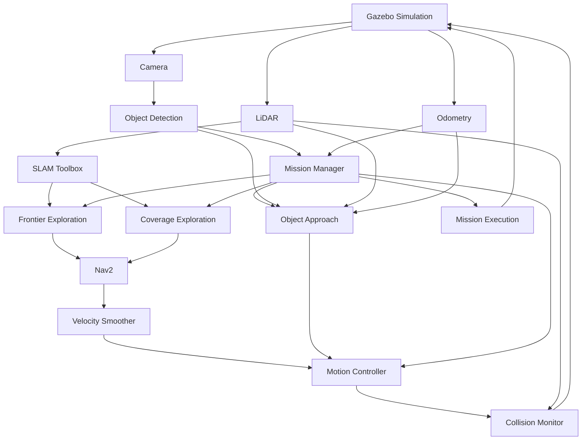

# Autonomous Escape Room Robot

## 1. 프로젝트 소개 (Project Overview)

**로봇도 방탈출 게임을 할 수 있을까?**

처음 보는 공간, 잠겨 있는 문, 어딘가에 숨겨진 열쇠. 로봇에게 주어진 목표는 스스로 탈출하는 것이다.

Autonomous Escape Room Robot은 방탈출 게임을 모티브로 한 ROS2 기반 자율 로봇 개발 프로젝트이다.

로봇은 사전 지도 없이 공간을 탐색하고, 주변에 있는 열쇠와 문을 인식한다. 탐색 과정에서 발견한 객체의 위치와 상태를 기억하고, 당장 열 수 없는 문은 이후 필요한 열쇠를 획득했을 때 다시 찾아가는 것을 목표로 한다.

단순히 정해진 목적지까지 이동하는 것을 넘어, 스스로 탐색하고, 발견한 정보를 기억하며, 상황에 따라 다음 행동을 결정하는 로봇을 구현하고자 한다.

## 2. 프로젝트 목표 (Project Goals)

- SLAM 기반 미지 환경 지도 생성
- Frontier 및 Coverage 기반 혼합 자율 탐색
- Nav2 기반 자율 주행 및 장애물 회피
- 카메라와 LiDAR 기반 객체 인식 및 접근
- 탐색 과정에서 획득한 정보 기억 및 활용
- FSM 기반 임무 관리 및 행동 전환
- 이동 제어권 자동 관리
- 단서 추론 및 조건 판단 기반 문제 해결
- 사람의 개입 없는 완전 자율 방탈출

## 3. 개발 환경 (Development Environment)

| Category | Environment |
| --- | --- |
| OS | Ubuntu 24.04 LTS |
| Middleware | ROS2 Jazzy |
| Simulator | Gazebo Harmonic |
| Robot | TurtleBot3 Burger Camera |
| Language | Python |
| SLAM | SLAM Toolbox |
| Navigation | Nav2 |
| Exploration | Explore Lite (m-explore-ros2), Custom Coverage Explorer |
| Computer Vision | OpenCV |
| Numerical Computing | NumPy |
| Mission Control | Finite State Machine (FSM) |
| Visualization | RViz2, rqt_image_view |
| Version Control | Git, GitHub |

## 4. 단계별 개발 목표 (Development Roadmap)

### LEVEL 1. 기본 자율 방탈출 (필수)

하나의 열쇠와 잠긴 문, 탈출구가 존재하는 환경에서 자율적으로 방탈출 임무를 수행한다.

- 미지 환경 지도 생성 및 자율 탐색
- 열쇠, 문, 탈출구 인식 및 자율 접근
- 열쇠 획득 및 소유 상태 관리
- 조건부 문 개방 및 통과
- FSM 기반 전체 임무 자동 관리

### LEVEL 2. 기억 기반 자율 방탈출 (필수)

여러 개의 열쇠와 문이 존재하는 환경에서 탐색 과정 중 발견한 정보를 기억하고 활용한다.

- 복수의 열쇠 및 문 인식
- 열쇠와 문의 대응 관계 판단
- 발견한 객체의 위치 및 상태 기억
- 기억한 객체의 위치 재방문
- 저장된 정보를 활용한 행동 결정

### LEVEL 3. 추론 기반 자율 방탈출 (확장)

환경에 존재하는 여러 단서를 수집하고, 이를 기반으로 추론하여 복합적인 방탈출 임무를 수행한다.

- 숫자 및 기호 단서 인식
- 단서 수집 및 기억
- 비밀번호 추론
- 임무 수행 순서 및 선행 조건 판단
- 제한 시간 내 완전 자율 방탈출

## 5. 시스템 구조 (System Architecture)

전체 시스템은 Mission Manager를 중심으로 환경 인식, 자율 탐색, 객체 접근, 임무 수행 및 이동 제어가 이루어지는 모듈형 구조로 구성된다.

각 모듈은 ROS2 토픽, 서비스 및 Action을 통해 데이터를 주고받으며, Mission Manager는 현재 임무 상태와 환경 정보를 기반으로 로봇의 행동을 결정한다.

## 6. 주요 기능 (Core Features)

### 6.1 지도 생성 및 자율 주행 (Mapping & Navigation)

SLAM Toolbox를 활용하여 사전 지도 없이 미지 환경의 지도를 생성한다. 생성된 지도와 센서 데이터를 기반으로 Nav2를 활용하여 이동 경로를 계획하고 장애물을 회피하며 목표 지점까지 자율 주행한다.

### 6.2 혼합 자율 탐색 (Hybrid Exploration)

미지 영역 탐색과 객체 발견을 효율적으로 수행하기 위해 Frontier Exploration과 Coverage Exploration을 결합한다.

- **Frontier Exploration:** 탐색된 영역과 미탐색 영역의 경계를 기반으로 새로운 공간을 탐색한다.
- **Coverage Exploration:** 지도 내 자유 공간을 기반으로 탐색 후보를 생성하고, 방문 이력과 탐색 우선순위를 고려하여 주변 객체를 추가로 탐색한다.

Frontier Exploration을 우선 수행하고, 목표 객체를 발견하지 못한 상태에서 Frontier가 소진되면 Coverage Exploration으로 전환하도록 구성한다.

### 6.3 객체 인식 및 자율 접근 (Object Detection & Approach)

OpenCV를 활용하여 카메라 영상에서 방탈출에 필요한 객체를 인식한다.

객체의 영상 내 위치 정보를 이용하여 로봇의 이동 방향을 조정하고, LiDAR 거리 정보를 기반으로 목표 객체에 자율적으로 접근한다.

### 6.4 기억 및 정보 관리 (Memory & Information Management)

탐색 과정에서 획득한 정보를 저장하고 이후 임무 수행에 활용하는 것을 목표로 한다.

- 탐색 지점의 방문 및 실패 이력
- 열쇠 획득 및 문 개방 상태
- 발견한 객체의 위치와 속성
- 방탈출에 필요한 단서 정보

저장된 정보를 기반으로 불필요한 반복 탐색을 줄이고, 필요한 객체를 재방문하는 기능으로 확장한다.

### 6.5 조건 판단 및 추론 (Reasoning & Decision Making)

획득한 열쇠, 객체의 상태 및 환경에서 수집한 단서를 기반으로 임무 수행 가능 여부를 판단한다.

단순한 조건 충족 여부 판단에서 나아가 비밀번호 추론, 선행 조건 확인 및 임무 수행 순서 결정으로 확장하는 것을 목표로 한다.

### 6.6 임무 자동 관리 (Mission Management)

FSM(Finite State Machine)을 기반으로 전체 방탈출 임무를 관리한다.

현재 임무 상태와 객체 인식 결과에 따라 탐색, 객체 접근, 열쇠 획득, 문 개방 및 탈출 등의 행동을 자동으로 전환한다.

### 6.7 이동 제어 및 충돌 방지 (Motion Control & Collision Prevention)

자율 주행과 객체 접근 과정에서 발생할 수 있는 이동 제어권 충돌을 방지하기 위해 Motion Controller를 활용한다.

| Control Mode | Description |
| --- | --- |
| NAVIGATION | Nav2 기반 자율 탐색 및 이동 |
| APPROACH | 객체 인식 기반 자율 접근 |
| STOP | 이동 명령 차단 및 정지 |

선택된 이동 명령은 Collision Monitor를 거쳐 로봇으로 전달되며, LiDAR 센서 데이터를 기반으로 주변 장애물과의 충돌 위험에 대응한다.
