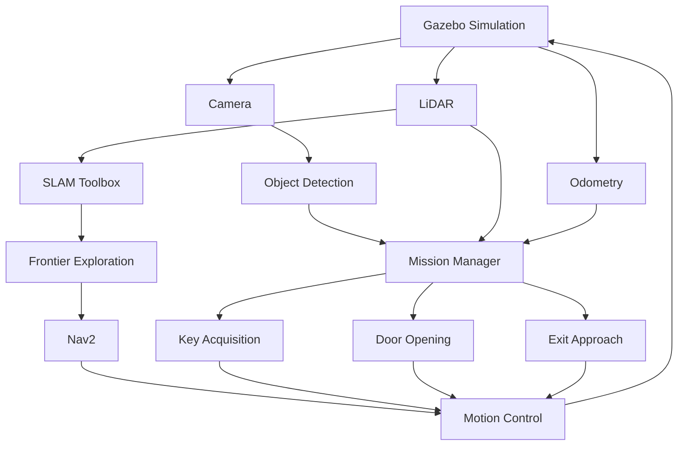

# Autonomous Escape Room Robot

## 1. 프로젝트 소개 (Project Overview)

ROS2 기반의 기억 및 추론 능력을 갖춘 자율 방탈출 로봇 개발 프로젝트

로봇이 사전 지도 없이 미지의 공간을 탐색하고, 카메라와 LiDAR를 활용하여 주변 환경과 객체를 인식한다. 탐색 과정에서 획득한 정보를 기억하고, 주어진 조건에 따라 다음 행동을 결정함으로써 스스로 방탈출 임무를 수행하는 것을 목표로 한다.

단순한 자율 주행을 넘어 환경 인식, 정보 기억, 조건 판단 및 추론을 기반으로 복합적인 임무를 수행하는 자율 로봇 시스템을 구현하고자 한다.

## 2. 프로젝트 목표 (Project Goals)

- SLAM 기반 미지 환경 지도 생성
- Frontier 기반 자율 탐색
- Nav2 기반 자율 주행 및 장애물 회피
- 카메라와 LiDAR 기반 객체 인식 및 접근
- 탐색 과정에서 획득한 정보 기억
- FSM 기반 임무 관리 및 행동 전환
- 단서 추론 및 조건 판단 기반 문제 해결
- 사람의 개입 없는 완전 자율 방탈출

## 3. 개발 환경 (Development Environment)

| Category | Environment |
| --- | --- |
| OS | Ubuntu 24.04 LTS |
| Middleware | ROS2 Jazzy |
| Simulator | Gazebo Harmonic |
| Robot | TurtleBot3 Burger Camera |
| Language | Python |
| SLAM | SLAM Toolbox |
| Navigation | Nav2 |
| Exploration | Explore Lite (m-explore-ros2) |
| Computer Vision | OpenCV |
| Visualization | RViz2, rqt_image_view |
| Version Control | Git, GitHub |

## 4. 단계별 개발 목표 (Development Roadmap)

### LEVEL 1. 기본 자율 방탈출

하나의 열쇠와 잠긴 문, 탈출구가 존재하는 환경에서 방탈출 임무를 수행한다.

- [x] SLAM 기반 지도 생성
- [x] Nav2 기반 자율 주행
- [x] Frontier 기반 자율 탐색
- [x] Gazebo 방탈출 환경 제작
- [x] 색상 기반 객체 인식
- [x] 카메라와 LiDAR 연계
- [x] 열쇠 자율 접근
- [x] 열쇠 획득 및 상태 기억
- [x] 열쇠 객체 자동 제거
- [x] 문 자율 탐색 및 접근
- [x] 조건부 문 자동 개방
- [x] 열린 문 통과
- [x] 탈출구 자율 접근
- [x] 탈출 성공 판단
- [ ] Mission Manager 구현
- [ ] FSM 기반 임무 전환
- [ ] 이동 제어권 자동 전환
- [ ] 전체 시스템 통합
- [ ] 완전 자율 방탈출 테스트

### LEVEL 2. 기억 기반 자율 방탈출

여러 개의 열쇠와 문이 존재하는 환경에서 탐색 과정 중 발견한 정보를 기억하고 활용한다.

- [ ] 복수의 열쇠 및 문 배치
- [ ] 열쇠와 문의 대응 관계 판단
- [ ] 발견한 객체의 위치 저장
- [ ] 열쇠 획득 상태 관리
- [ ] 개방할 수 없는 문의 위치 기억
- [ ] 열쇠 획득 이후 기존에 발견한 문 재방문
- [ ] 기억 기반 임무 수행
- [ ] 전체 시스템 테스트

### LEVEL 3. 추론 기반 자율 방탈출

환경에 존재하는 여러 단서를 수집하고, 이를 기반으로 추론하여 복합적인 방탈출 임무를 수행한다.

- [ ] 숫자 및 기호 단서 인식
- [ ] 단서 수집 및 기억
- [ ] 비밀번호 추론
- [ ] 임무 수행 순서 판단
- [ ] 선행 조건 기반 문 개방
- [ ] 제한 시간 내 임무 수행
- [ ] 기억 및 추론 기반 완전 자율 방탈출

## 5. 시스템 구조 (System Architecture)

※ 전체 시스템 통합을 목표로 한 설계 구조이며,
현재는 각 핵심 기능을 개별 노드 단위로 구현하고 검증한 상태이다.

## 6. 주요 기능 (Core Features)

### 6.1 자율 탐색 (Autonomous Exploration)

SLAM Toolbox를 이용하여 미지 환경의 지도를 생성하고,
Frontier Exploration을 활용하여 탐색된 영역과 미탐색 영역의
경계를 기반으로 다음 탐색 목표를 결정한다.

Nav2를 활용하여 목표 위치까지 자율 주행한다.

### 6.2 객체 인식 (Object Detection)

OpenCV의 HSV 색상 공간을 활용하여 방탈출에 필요한 객체를 인식한다.

| Object | Color | Description |
| --- | --- | --- |
| KEY | Yellow | 문을 열기 위한 열쇠 |
| DOOR | Red | 잠긴 문 |
| EXIT | Green | 최종 탈출구 |

객체의 중심 좌표, 크기 및 면적 정보를 추출하여
ROS2 토픽으로 전달한다.

### 6.3 객체 자율 접근 (Autonomous Object Approach)

카메라 영상에서 인식한 객체의 중심 좌표를 이용하여
로봇의 방향을 제어한다.

객체가 화면 중앙에 위치하면 LiDAR 전방 거리 정보를
활용하여 목표물에 접근한다.

- 객체가 왼쪽에 위치하면 좌회전
- 객체가 오른쪽에 위치하면 우회전
- 객체가 중앙에 위치하면 전진
- 목표 거리 이내로 접근하면 정지
- 이동 중 방향 오차 발생 시 자동 보정

### 6.4 열쇠 획득 (Key Acquisition)

열쇠를 인식하고 목표 거리 0.5m 이내에 접근한 상태가
5회 연속 확인되면 열쇠 획득에 성공한 것으로 판단한다.

획득 상태를 ROS2 토픽으로 발행하고,
Gazebo의 객체 제거 서비스를 호출하여 열쇠를 제거한다.

실제 물리적 파지 대신 논리적인 객체 획득 방식을 사용한다.

### 6.5 문 자동 개방 (Automatic Door Opening)

열쇠 획득 및 제거 상태와 문 접근 완료 상태를 확인한다.

두 조건을 모두 만족할 경우 Gazebo 환경에서
문 객체를 제거하여 새로운 공간으로 이동할 수 있도록 한다.

### 6.6 탈출 성공 판단 (Escape Success)

문 개방 이후 Odometry 데이터를 활용하여 문을 통과한다.

초록색 탈출구를 탐색하고 자율적으로 접근하며,
목표 거리 이내 접근 조건을 5회 연속 만족하면
탈출 성공 상태를 발행하고 로봇을 정지시킨다.

## 7. 프로젝트 구조 (Project Structure)

| File | Description |
| --- | --- |
| escape_room.world | 방탈출 시뮬레이션 환경 |
| escape_room.launch.py | 방탈출 환경 실행 |
| object_detector.py | 색상 기반 객체 인식 |
| distance_test.py | 카메라 및 LiDAR 연계 검증 |
| key_approach.py | 열쇠 자율 접근 및 획득 |
| key_remover.py | 열쇠 객체 자동 제거 |
| door_approach.py | 문 탐색 및 자율 접근 |
| door_opener.py | 조건부 문 자동 개방 |
| exit_approach.py | 문 통과 및 탈출 성공 판단 |
